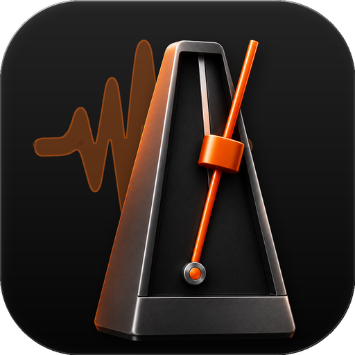
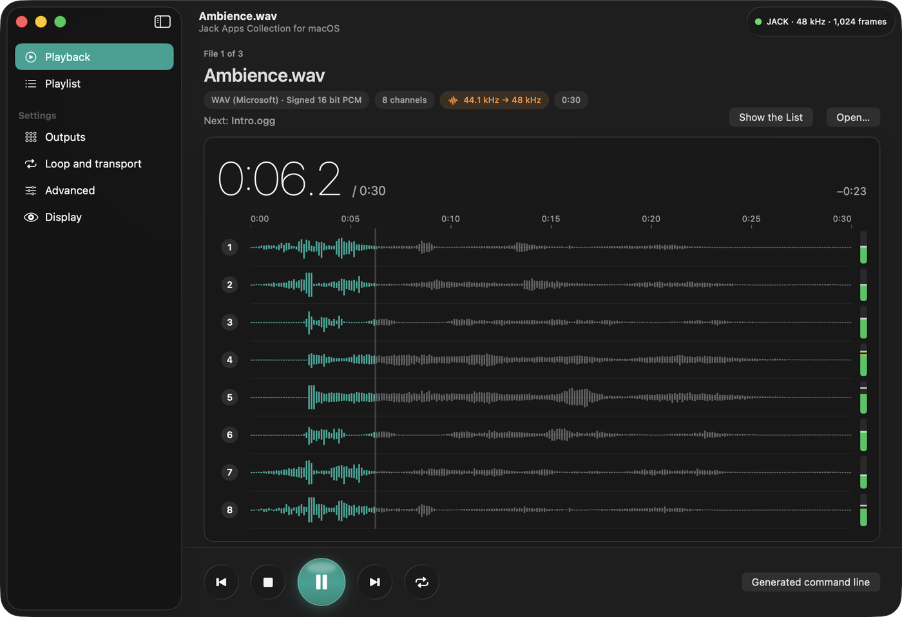
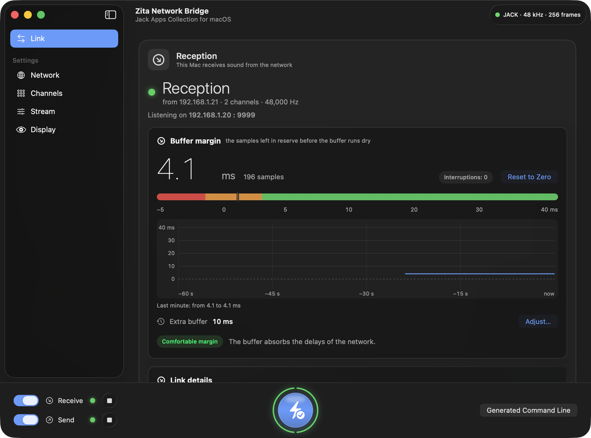
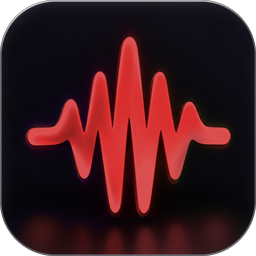

  <h1>Jack Apps Collection for macOS</h1>
  
Useful JACK tools for macOS, and native graphical interfaces for them.

  

    
    <strong>Signed &amp; notarized by Apple</strong>
  

  

    
  

---

Tools are built for Apple Silicon and Intel, and get a SwiftUI application where it makes sense. They are added one at a time, as they are finished.

## Tools

| Icon&nbsp;&nbsp;&nbsp;&nbsp;&nbsp;&nbsp;&nbsp;&nbsp;&nbsp;&nbsp;&nbsp;&nbsp;&nbsp;&nbsp;&nbsp;&nbsp;&nbsp;&nbsp;&nbsp;&nbsp;&nbsp;&nbsp; | Name | Description | CLI | GUI | Notarized package |
|---|---|---|---|---|---|
|  | [Jack Capture](jack_capture/) | Records JACK audio to a file. An interface for `jack_capture` by Kjetil Matheussen ([upstream](https://github.com/kmatheussen/jack_capture)). | ✓ | ✓ | [Download 0.9.73](https://github.com/zinc75/jack-apps-collection-macos/releases/download/jack_capture-v0.9.73-macOS-6/JackCapture-0.9.73-macOS-6.pkg) (revision 6) |
|  | [Klick](klick/) | A metronome with tempo maps that plays in JACK and can follow the JACK transport. An interface for `klick` by Dominic Sacré ([upstream](https://github.com/dsacre/klick)). The same application without JACK is [Klick Tempo](https://github.com/zinc75/klick-tempo). | ✓ | ✓ | [Download 0.13.0](https://github.com/zinc75/jack-apps-collection-macos/releases/download/klick-v0.13.0-macOS-3/Klick-0.13.0-macOS-3.pkg) (revision 3) |
|  | [Jack Play](jack_play/) | Plays sound files and playlists in JACK, with no gap between files, and connects each channel where you choose. An interface for `jack_play`, the `rju-play` player by Rohan Drape ([upstream](https://github.com/rd--/rju)). | ✓ | ✓ | [Download 0.19](https://github.com/zinc75/jack-apps-collection-macos/releases/download/jack_play-v0.19-macOS-3/JackPlay-0.19-macOS-3.pkg) (revision 3) |
|  | [Zita Network Bridge](zita-njbridge/) | Carries multichannel audio between two Macs over a network, with adaptive resampling. An interface for `zita-njbridge` (`zita-j2n` and `zita-n2j`) by Fons Adriaensen ([upstream](https://kokkinizita.linuxaudio.org/linuxaudio/)). | ✓ | ✓ | [Download 0.4.8](https://github.com/zinc75/jack-apps-collection-macos/releases/download/zita-njbridge-v0.4.8-macOS-3/ZitaNetworkBridge-0.4.8-macOS-3.pkg) (revision 3) |
|  | [Jack Convolver](jconvolver/) | Reverbs, decoders and filters as a matrix of convolutions, in real time in JACK or on sound files, up to 128 inputs and 128 outputs. A matrix to edit the impulse responses and plots to inspect them. An interface for `jconvolver` and `fconvolver` by Fons Adriaensen ([upstream](https://kokkinizita.linuxaudio.org/linuxaudio/)). The programs and `makemulti` are installed too. | ✓ | ✓ | [Download 1.1.0](https://github.com/zinc75/jack-apps-collection-macos/releases/download/jconvolver-v1.1.0-macOS/jconvolver-1.1.0-macOS.pkg) (revision 1) |

### Screenshots

  
   <em>Jack Capture: recording, with the level of each channel</em>

---

  
   <em>Klick: the simplified view of the metronome while it runs</em>

---

  
   <em>Jack Play: playing an 8 channel file, with its waveforms</em>

---

  
   <em>Zita Network Bridge: receiving from another Mac, with the buffer margin</em>

## Companion apps

I also develop two apps that are not part of this repository, each with its own site and its own GitHub repository. On macOS they make JACK much simpler to use.

| Icon&nbsp;&nbsp;&nbsp;&nbsp;&nbsp;&nbsp;&nbsp;&nbsp;&nbsp;&nbsp;&nbsp;&nbsp;&nbsp;&nbsp;&nbsp;&nbsp;&nbsp;&nbsp;&nbsp;&nbsp;&nbsp;&nbsp; | Name | Description |
|---|---|---|
|  | [JackMate](https://jackmate.app) · [GitHub](https://github.com/zinc75/JackMate) | The easiest way to [install a notarized JACK](https://jackmate.app/install-jack-macos.html#one-clic-method-from-jackmate) and start it, a [patchbay](https://jackmate.app/guide/patchbay.html) to see and edit every connection, the JACK transport, and studios that save a whole setup to restore in one click. The apps of this collection appear in it as clients. Free and open source (MIT). |
|  | [JackMoebius](https://jackmoebius.io) · [GitHub](https://github.com/zinc75/JackMoebius) | The modern replacement for JackRouter on macOS. It exposes applications that only speak CoreAudio as JACK clients, one per application and in both directions, so JACK tools can record them, process them or feed them. A commercial app, signed and notarized by Apple, with a 14-day trial and then a one-time license. |

## Version numbers

The version number of a package, and of the application inside it, is the version number of the upstream program it is built from. Jack Capture 0.9.73 is `jack_capture` 0.9.73, and Zita Network Bridge 0.4.8 is `zita-njbridge` 0.4.8. The number tells which upstream version the application drives, not how mature the interface is.

When the macOS edition is published again for the same upstream version, a revision number is added to the name of the package, as in `JackCapture-0.9.73-macOS-2.pkg`. The About window of each application reads "0.9.73 macOS Edition". Where upstream has no release for a given state, the README of the tool says which commit the version stands for.

## About this repository

Each tool keeps its original sources untouched in `upstream/`, with the changes needed for macOS as patches in `patches/`. Fixes that are not specific to this repository are sent to the original authors.

Some folders are Git submodules, each fixed at a given commit of its own repository:

| Submodule | What it is |
|---|---|
| `jack_capture/upstream` | `jack_capture` by Kjetil Matheussen, from its [official repository](https://github.com/kmatheussen/jack_capture), unmodified |
| `jack_play/upstream` | `rju` (`rju-play`) by Rohan Drape, from its [repository](https://github.com/rd--/rju), unmodified, with its own `r-common` submodule |
| `klick/klick-tempo` | [klick-tempo](https://github.com/zinc75/klick-tempo), the core of Klick and the same application without JACK, in its own repository |
| `klick/klick-tempo/klick/upstream` | `klick` by Dominic Sacré, from its [official repository](https://github.com/dsacre/klick), unmodified, inside klick-tempo |
| `zita-njbridge/upstream` | `zita-njbridge` by Fons Adriaensen: [zinc75/zita-njbridge-releases](https://github.com/zinc75/zita-njbridge-releases), the files of its release archive, one commit per release |
| `jconvolver/upstream` | `jconvolver` by Fons Adriaensen: [zinc75/jconvolver-releases](https://github.com/zinc75/jconvolver-releases), the files of its release archive, one commit per release |
| `libs/libogg/upstream` | `libogg` by Xiph.Org, from its [official repository](https://github.com/xiph/ogg), at the tag of the release used, unmodified |
| `libs/libvorbis/upstream` | `libvorbis` by Xiph.Org, from its [official repository](https://github.com/xiph/vorbis), at the tag of the release used, unmodified |
| `libs/libsamplerate/upstream` | `libsamplerate` by Erik de Castro Lopo and contributors, from its [official repository](https://github.com/libsndfile/libsamplerate), at the tag of the release used, unmodified |
| `libs/libsndfile/upstream` | `libsndfile` by Erik de Castro Lopo and contributors, from its [official repository](https://github.com/libsndfile/libsndfile), at the tag of the release used, unmodified |
| `libs/flac/upstream` | `flac` by Xiph.Org, from its [official repository](https://github.com/xiph/flac), at the tag of the release used, unmodified |
| `libs/boost/upstream` | Boost, by the Boost community: [zinc75/boost-subset](https://github.com/zinc75/boost-subset), the 492 headers that klick needs, from the release archive, one commit per release |
| `libs/liblo/upstream` | `liblo` by Stephen Sinclair and contributors, from its [official repository](https://github.com/radarsat1/liblo), at the tag of the release used, unmodified |
| `libs/opus/upstream` | `opus` by Xiph.Org and contributors, from its [official repository](https://github.com/xiph/opus), at the tag of the release used, unmodified |
| `libs/rubberband/upstream` | `rubberband` by Breakfast Quay, from its [official repository](https://github.com/breakfastquay/rubberband), at the tag of the release used, unmodified |
| `libs/mpg123/upstream` | `mpg123` by Michael Hipp and others, maintained by Thomas Orgis since 2006: [zinc75/mpg123-releases](https://github.com/zinc75/mpg123-releases), the files of its release archive (signed by its maintainer), one commit per release |
| `libs/lame/upstream` | `LAME` by The LAME Project and its contributors: [zinc75/lame-releases](https://github.com/zinc75/lame-releases), the files of its release archive, one commit per release |
| `libs/zita-resampler/upstream` | `zita-resampler` by Fons Adriaensen (the NEON code is by Nicolas Belin): [zinc75/zita-resampler-releases](https://github.com/zinc75/zita-resampler-releases), the files of its release archive, one commit per release |
| `libs/clthreads/upstream` | `clthreads` by Fons Adriaensen: [zinc75/clthreads-releases](https://github.com/zinc75/clthreads-releases), the files of its release archive, one commit per release |
| `libs/zita-convolver/upstream` | `zita-convolver` by Fons Adriaensen: [zinc75/zita-convolver-releases](https://github.com/zinc75/zita-convolver-releases), the files of its release archive, one commit per release |
| `libs/fftw/upstream` | `FFTW` by Matteo Frigo and Steven G. Johnson: [zinc75/fftw-releases](https://github.com/zinc75/fftw-releases), the files of its release archive, one commit per release |

Clone with `git clone --recurse-submodules`, or run `git submodule update --init --recursive` in a clone made without it.

## Contributing

Bug reports, fixes, corrections of translations and new languages are welcome: see [`CONTRIBUTING.md`](CONTRIBUTING.md).

## Support

Jack Apps Collection is free and open source. If it saves you time, you can buy me a coffee: it helps pay the Apple Developer account ($99 a year) that keeps the installers signed and notarized.

## Licence

Each tool keeps the licence of its original project, see [`LICENSES.md`](LICENSES.md). The documentation is MIT-licensed.
