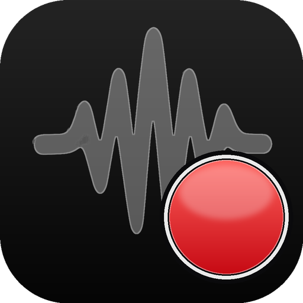
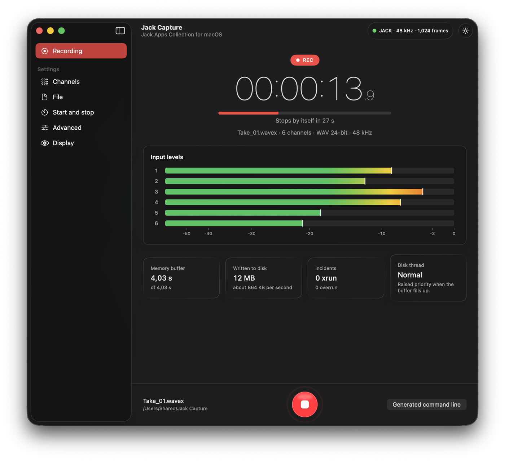

  <h1>Jack Apps Collection for macOS</h1>
  
Useful JACK tools for macOS, and native graphical interfaces for them.

  

    
    <strong>Signed &amp; notarized by Apple</strong>
  

---

Tools are built for Apple Silicon and Intel, and get a SwiftUI application where it makes sense. They are added one at a time, as they are finished.

## Applications

| | | |
|---|---|---|
|  | [Jack Capture](jack_capture/) | Records JACK audio to a file. An interface for `jack_capture` by Kjetil Matheussen. |

  

## About this repository

Each tool keeps its original sources untouched in `upstream/`, with the changes needed for macOS as patches in `patches/`. Fixes that are not specific to this repository are sent to the original authors.

## Licence

Each tool keeps the licence of its original project, see [`LICENSES.md`](LICENSES.md). The documentation is MIT-licensed.
