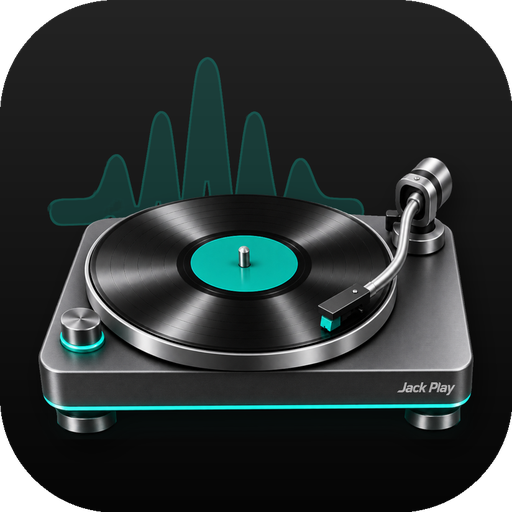

  <h1>Jack Apps Collection for macOS</h1>
  
Useful JACK tools for macOS, and native graphical interfaces for them.

  

    
    <strong>Signed &amp; notarized by Apple</strong>
  

  

    
  

---

Tools are built for Apple Silicon and Intel, and get a SwiftUI application where it makes sense. They are added one at a time, as they are finished.

## Applications

| Icon&nbsp;&nbsp;&nbsp;&nbsp;&nbsp;&nbsp;&nbsp;&nbsp;&nbsp;&nbsp;&nbsp;&nbsp;&nbsp;&nbsp;&nbsp;&nbsp;&nbsp;&nbsp;&nbsp;&nbsp;&nbsp;&nbsp; | Name | Description | Notarized package |
|---|---|---|---|
|  | [Jack Capture](jack_capture/) | Records JACK audio to a file. An interface for `jack_capture` by Kjetil Matheussen ([upstream](https://github.com/kmatheussen/jack_capture)). | [Download 0.9.73](https://github.com/zinc75/jack-apps-collection-macos/releases/download/jack_capture-v0.9.73-macOS-3/JackCapture-0.9.73-macOS-3.pkg) |
|  | [Klick](klick/) | A metronome with tempo maps that plays in JACK and can follow the JACK transport. An interface for `klick` by Dominic Sacré ([upstream](https://github.com/dsacre/klick)). The same application without JACK is [Klick Tempo](https://github.com/zinc75/klick-tempo). | [Download 0.13.0](https://github.com/zinc75/jack-apps-collection-macos/releases/download/klick-v0.13.0-macOS/Klick-0.13.0-macOS.pkg) |
|  | [Jack Play](jack_play/) | Plays sound files and playlists in JACK, with no gap between files, and connects each channel where you choose. An interface for `jack_play`, the `rju-play` player by Rohan Drape ([upstream](https://github.com/rd--/rju)). | [Download 0.19](https://github.com/zinc75/jack-apps-collection-macos/releases/download/jack_play-v0.19-macOS/JackPlay-0.19-macOS.pkg) |

  
   <em>Jack Capture</em>

---

  
   <em>Klick</em>

---

  
   <em>Jack Play</em>

## About this repository

Each tool keeps its original sources untouched in `upstream/`, with the changes needed for macOS as patches in `patches/`. Fixes that are not specific to this repository are sent to the original authors.

Some folders are Git submodules, each fixed at a given commit of its own repository:

| Submodule | What it is |
|---|---|
| `jack_capture/upstream` | `jack_capture` by Kjetil Matheussen, from its [official repository](https://github.com/kmatheussen/jack_capture), unmodified |
| `klick/klick-tempo` | [klick-tempo](https://github.com/zinc75/klick-tempo), the core of Klick and the same application without JACK, in its own repository |
| `klick/klick-tempo/klick/upstream` | `klick` by Dominic Sacré, from its [official repository](https://github.com/dsacre/klick), unmodified, inside klick-tempo |

Clone with `git clone --recurse-submodules`, or run `git submodule update --init --recursive` in a clone made without it.

## Support

Jack Apps Collection is free and open source. If it saves you time, you can buy me a coffee: it helps pay the Apple Developer account ($99 a year) that keeps the installers signed and notarized.

## Licence

Each tool keeps the licence of its original project, see [`LICENSES.md`](LICENSES.md). The documentation is MIT-licensed.
