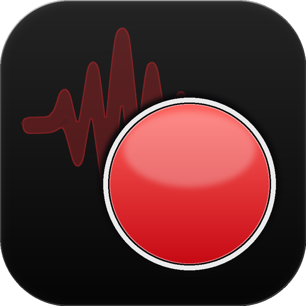
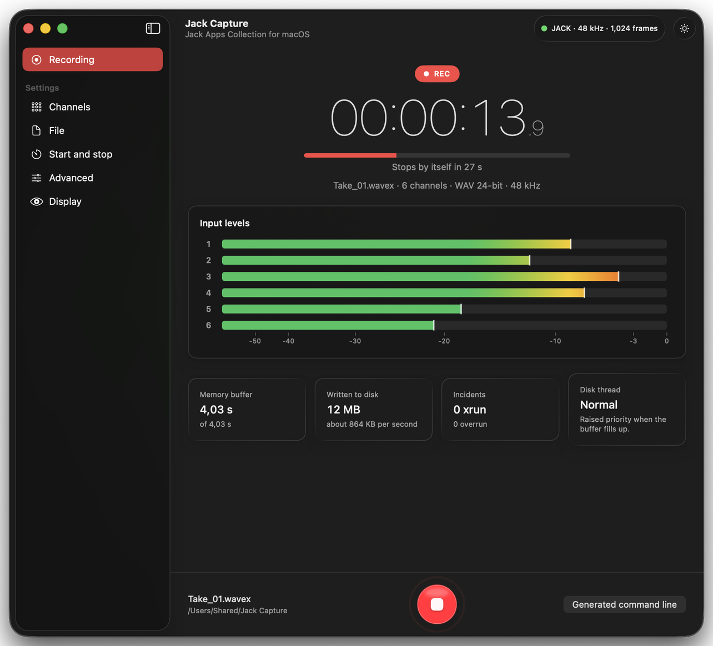
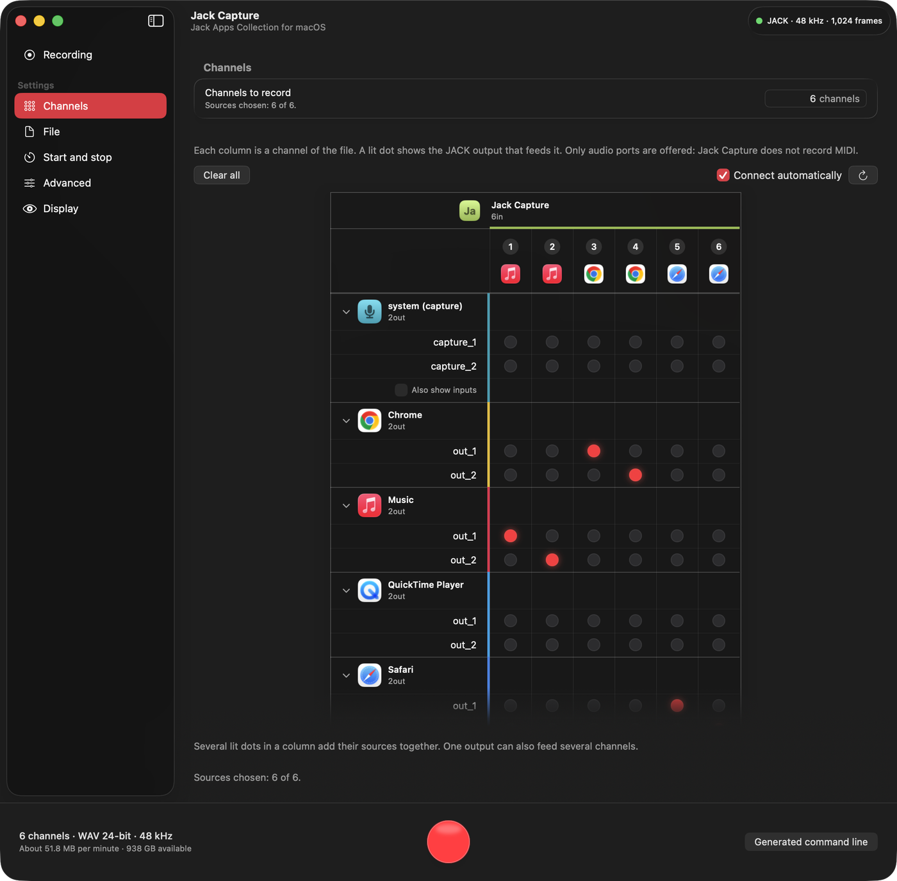
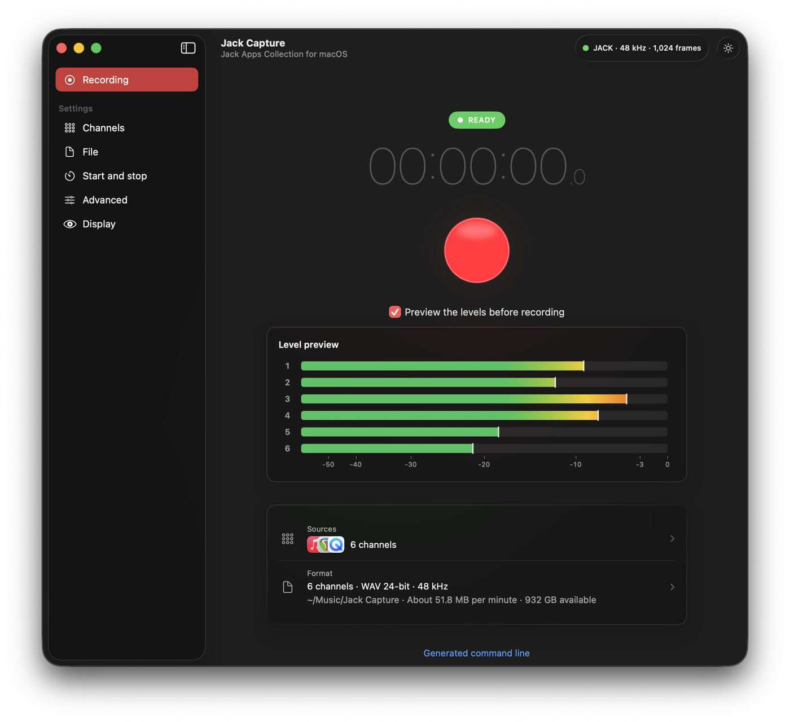
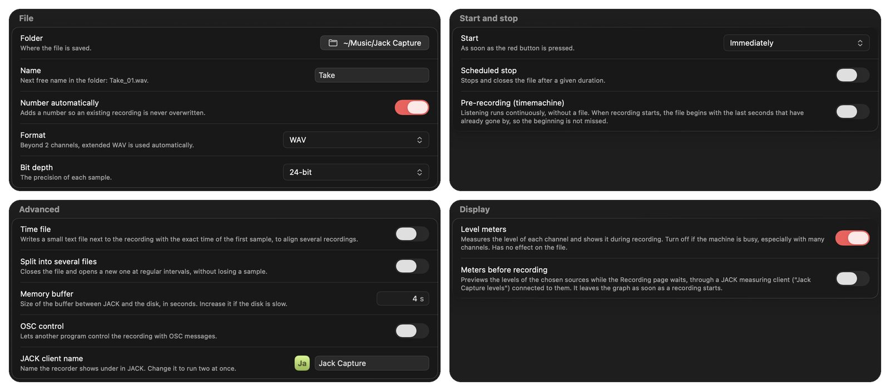

<div align="center">

  
  <h1>Jack Capture</h1>
  <p>A native macOS interface for <code>jack_capture</code>, the JACK recorder by Kjetil Matheussen.</p>
  <p>
    
    <strong>Signed &amp; notarized by Apple</strong>
  </p>

  
  
  
  [](https://www.buymeacoffee.com/zinc75)

  

</div>

---

Choose which JACK outputs feed each channel of the file, check the levels, press the red button. The application starts the `jack_capture` program, built here for macOS (arm64 and x86_64) with patches that are also sent upstream, and does not replace it: the command-line program keeps all its options.

Jack Capture is an unofficial interface. It is part of Jack Apps Collection for macOS.

## Install

Download `JackCapture-0.9.73-macOS.pkg` from the [Releases](https://github.com/zinc75/jack-apps-collection-macos/releases) page and open it. The package is signed and notarized by Apple, so it opens without any Gatekeeper warning. It installs the application in `/Applications/Jack Apps Collection/` and the `jack_capture` program in `/usr/local/bin`.

It needs macOS 15 or later, and [JACK](https://jackaudio.org/downloads/) installed.

To build from source instead, see [`swiftui/README.md`](swiftui/README.md).

## Choose the sources

A matrix connects each channel of the file to a JACK output. Applications show their own icon when JackMoebius or JACK metadata identifies them. A source that is not running yet can be chosen too: it is connected when it appears. Before a recording starts, the application warns if a channel has no source or a chosen source is missing.

<div align="center">
  
</div>

## Check the levels

<div align="center">
  
</div>

The Recording page previews the input levels while it waits (this can be turned off). During a recording it shows the elapsed time, a progress bar when a duration is set, the amount written to disk, the state of the memory buffer and the count of xruns and overruns.

## All the options of jack_capture

<div align="center">
  
</div>

File format and bit depth, folder and automatic numbering, scheduled stop, pre-recording (timemachine), time file, split into several files, memory buffer, OSC control and JACK client name. The generated command line can be shown at any time, and settings are kept between launches.

The interface is in French, English, German, Italian and Spanish. The German, Italian and Spanish translations have not been reviewed by native speakers. It needs macOS 15 or later.

## Uninstall

There is no uninstaller. To remove what the package installed:

```
sudo rm -rf "/Applications/Jack Apps Collection/Jack Capture.app" /usr/local/bin/jack_capture /usr/local/share/doc/jack_capture
sudo pkgutil --forget io.github.zinc75.jackappscollection.jackcapture.pkg
```

The settings of the application are in `~/Library/Preferences/io.github.zinc75.jackappscollection.jackcapture.plist`; `defaults delete io.github.zinc75.jackappscollection.jackcapture` removes them. Your recordings are not touched.

## Support

Jack Capture is free and open source. If it saves you time, you can buy me a coffee: it helps pay the Apple Developer account ($99 a year) that keeps the installers signed and notarized.

[](https://www.buymeacoffee.com/zinc75)

## Changes compared with upstream

**CLI.** The `jack_capture` program is upstream's, with six small patches. Three make it build and run on macOS: no `sys/sysinfo.h`, no `-latomic`, and a quality-of-service class for the disk thread. Two make the format and library probes use the same compiler and flags as the build, so that a static build finds its codecs. The last one fixes the `.tme` file, where the leading zeros of the nanoseconds were dropped (5 ms read as 0.5 s). The patches are also sent upstream. The program is built as a universal binary, with libsndfile and its FLAC, Ogg Vorbis, Opus and MP3 codecs linked statically.

**GUI.** The application starts `jack_capture` with the options you set and shows what it does. It adds one function that `jack_capture` does not have: the level preview of the inputs while it waits for you to record.

## Upstream

| | |
|---|---|
| Project | jack_capture |
| Author | Kjetil Matheussen |
| Source | https://github.com/kmatheussen/jack_capture |
| Version | commit `a539d444d388c4cfed7279e385830e7767d59c41` (2023-01-04, 40 commits after tag 0.9.73), upstream branch `master` |
| Copy here | `upstream/` = a Git submodule of the repository above, at the commit above, **unmodified** (clone with `--recurse-submodules`) |

## Licence

GPL-2.0-or-later (`COPYING` is the GPL v2; the source headers say "version 2 … or (at your option) any later version").

Dependencies: JACK, libsndfile; optional: LAME (MP3), liblo (OSC).

## State on macOS

`jack_capture` runs on arm64 and x86_64. `build_universal.sh` builds the universal binary (macOS 11.0 minimum) from the upstream sources and the patches below, with the libraries of `libs/` built first by their own `build_universal.sh`. The binary links libsndfile with FLAC, Ogg Vorbis, Opus and MP3 (LAME), mpg123 and liblo statically; its only dynamic dependencies are `libSystem` and `libjack` (full path, `/usr/local/lib`).

Tested on macOS, on arm64 and on x86_64 (under Rosetta).

### Patches

The program is built from the upstream sources, as published by Kjetil Matheussen (`upstream/`, commit `a539d44`), with the patches of `patches/`, sent upstream as pull requests [#59](https://github.com/kmatheussen/jack_capture/pull/59), [#60](https://github.com/kmatheussen/jack_capture/pull/60), [#61](https://github.com/kmatheussen/jack_capture/pull/61), [#62](https://github.com/kmatheussen/jack_capture/pull/62), [#63](https://github.com/kmatheussen/jack_capture/pull/63), [#65](https://github.com/kmatheussen/jack_capture/pull/65).

## Layout

- `upstream/`: the original sources, a Git submodule of the official repository, never edited (changes go to `patches/` or to new files).
- `patches/`: changes to the upstream sources, as unified diffs that apply with `git apply` from the `upstream/` directory.
- `screenshots/`: the images of this README.
- `swiftui/`: the Jack Capture application (GPL-2.0-or-later, as `jack_capture`), with its tests and build script.
