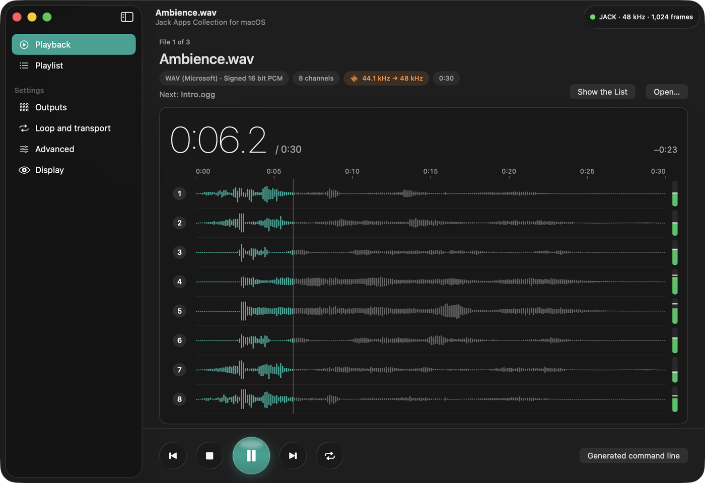
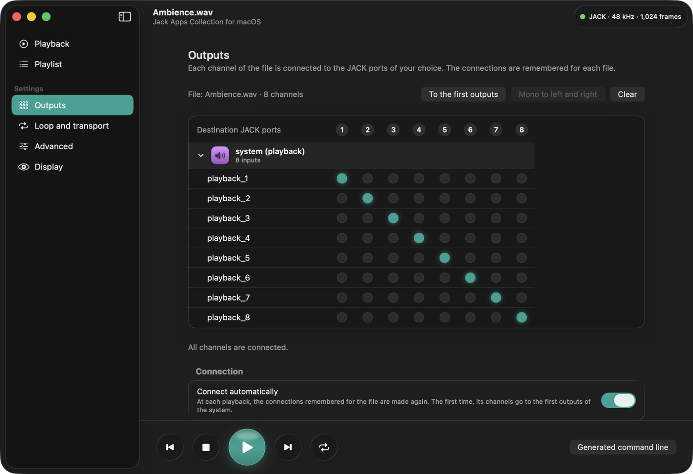
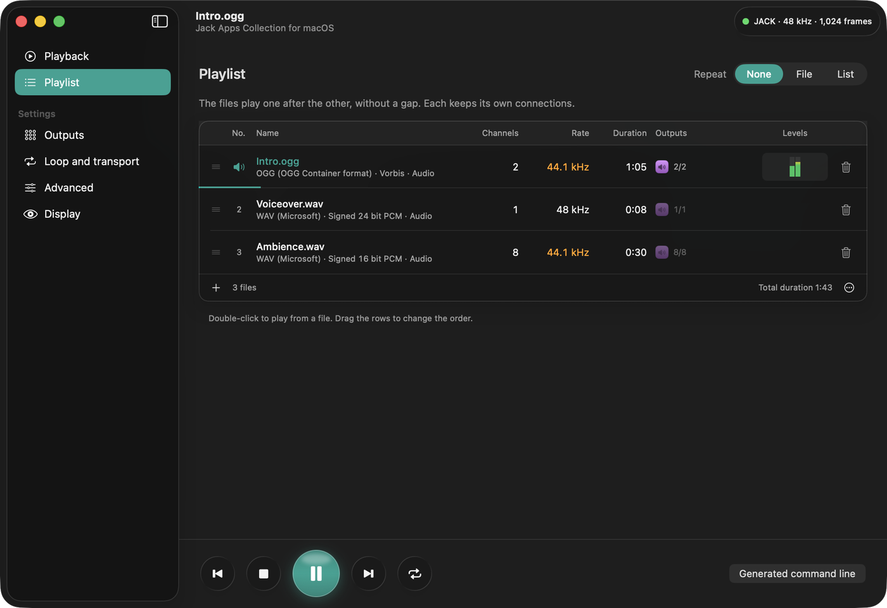
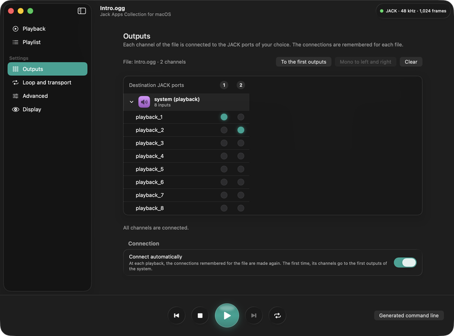
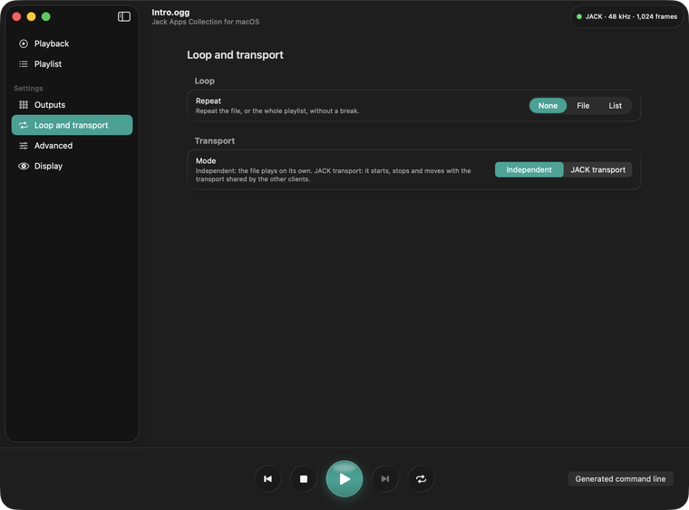
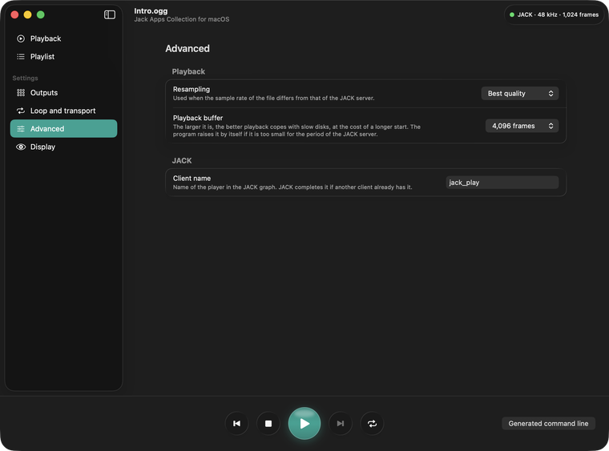
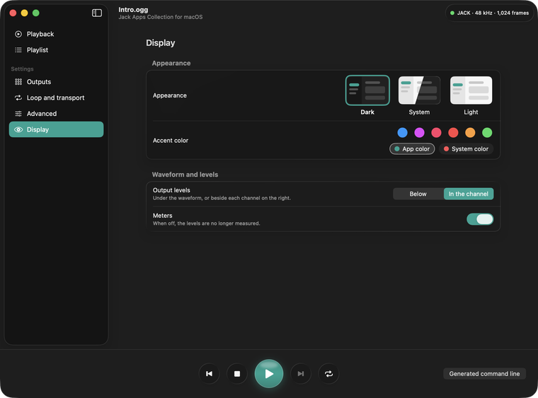

<div align="center">

  
  <h1>Jack Play</h1>
  <p>A native macOS interface for <code>jack_play</code>, the JACK sound file player (<code>rju-play</code> by Rohan Drape).</p>

  
  
  
  [](https://www.buymeacoffee.com/zinc75)

  

</div>

---

Open sound files, connect each channel to the JACK inputs of your choice, press play. Jack Play shows the waveform and the output levels, plays a list of files one after the other with no gap, and remembers the connections of each file. The application starts the `jack_play` program, built here for macOS (arm64 and x86_64), and does not replace it: the command-line program keeps all its options.

Jack Play is an unofficial interface. It is part of Jack Apps Collection for macOS.

## Install

Download `JackPlay-0.19-macOS.pkg` from the [Releases](https://github.com/zinc75/jack-apps-collection-macos/releases?q=Jack+Play) page and open it. It installs the application in `/Applications/Jack Apps Collection/` and the `jack_play` program in `/usr/local/bin`.

It needs macOS 15 or later, and [JACK](https://jackaudio.org/downloads/) installed.

To build from source instead, see [`swiftui/README.md`](swiftui/README.md).

## Connect the outputs

A matrix connects each channel of the file to the JACK inputs of your choice, grouped by client. Applications show their own icon when JackMoebius identifies them, and the shared input of JackMoebius has its own badge. The connections are remembered for each file (its name, size and date) and made again when the ports come back. The first time, the channels go to the first outputs of the system.

<div align="center">
  
</div>

## Play and watch

The waveform of the file has a time ruler: a click or a drag moves in the file. The output levels of every channel are measured inside the program, just before the ports, on the IEC scale, and shown beside the lane of each channel or under the waveform. A file with many channels (an ambisonic recording, for instance) is shown in columns, each with its own ruler, so that the lanes keep a height that can be read. The levels can be switched off, and are then not measured at all. By default the application plays on its own, so that starting it does not start the other clients of the server; it can also follow the JACK transport, and command it or only watch it.

## Play files one after the other

Open several files, drop them on the window or add them to the list. The files play with no gap: the program of the next file is started in advance, with its ports connected as that file asks, and told at which JACK frame to start, so its first sample follows the last sample of the file that ends. It is the same for every file, whatever its number of channels and its sample rate. The order is changed by dragging the rows, the list can repeat (the file or the whole list), and the table shows for each file its channels, its rate (in orange when the server's is different), its duration, where it is connected and, for the file that plays, its levels.

Each file is played by a program of its own, a JACK client named after its place in the list (`01 of 12 - jack_play`, then `02 of 12 - jack_play`), because two clients of the same name cannot live together. The list is read from and saved to a playlist file (M3U8, which other players read too), and the list and the file that was open come back at the next launch. A playlist does not play with the JACK transport, which decides alone.

<div align="center">
  
</div>

## All the options of jack_play

<div align="center">
<table>
<tr>
<td align="center"><br><sub>Outputs</sub></td>
<td align="center"><br><sub>Loop and transport</sub></td>
</tr>
<tr>
<td align="center"><br><sub>Advanced</sub></td>
<td align="center"><br><sub>Display</sub></td>
</tr>
</table>
</div>

Repeat (none, the file or the list), resampling quality, playback buffer, JACK client name, the way to play (on its own or with the JACK transport), and where the levels are shown. The generated command line can be shown at any time. The program is also usable alone, and keeps all its options:

```
jack_play [options] sound-file...
```

The settings of the application are kept between launches. The interface is in French, English, German, Italian and Spanish. The German, Italian and Spanish translations were written without a native speaker: corrections and new languages are welcome, see [`CONTRIBUTING.md`](../CONTRIBUTING.md). It needs macOS 15 or later.

## Uninstall

There is no uninstaller. To remove what the package installed:

```
sudo rm -rf "/Applications/Jack Apps Collection/Jack Play.app" /usr/local/bin/jack_play /usr/local/share/doc/jack_play
sudo pkgutil --forget io.github.zinc75.jackappscollection.jackplay.pkg
```

The settings of the application are in `~/Library/Preferences/io.github.zinc75.jackappscollection.jackplay.plist`; `defaults delete io.github.zinc75.jackappscollection.jackplay` removes them. Your sound files and playlists are not touched.

## Support

Jack Play is free and open source. If it saves you time, you can buy me a coffee: it helps pay the Apple Developer account ($99 a year) that keeps the installers signed and notarized.

[](https://www.buymeacoffee.com/zinc75)

## Changes compared with upstream

**CLI.** The program is upstream's, with ten patches. Four fixes found while porting were sent to the author and are in upstream since the commit below, so they are no longer patches:

- The end of the file is played in full. Before, the JACK client was closed as soon as the last block had been read from disk, which cut the end of every file by the size of the ring buffer (about 85 ms with the default `-b`, more with a larger one).
- In transport mode, a start or a locate empties the ring buffer. Before, the audio read before the seek was played first, so after a start from the beginning the first block of the file was heard twice.
- In transport mode, the position is converted from the frames of the server to the frames of the file. Before, the number of the transport frame was used as it was: with a file at 44.1 kHz on a server at 48 kHz, a locate to 2.000 s started 2.177 s into the file.
- When the file and the server have the same sample rate (and no `-r`), the audio is copied to the output as it is. Upstream always passed it through libsamplerate, even at a ratio of 1.0, so the output was not the file: the largest difference was 0.0375 (about -28 dBFS) on a test signal with high frequency content, and after a locate with `-t` the filter rang for about ten frames. Nothing changes when the rates differ.

The patches:

- The default client name is `jack_play` instead of `rju-play`.
- A new option, `-M`, makes the program say where it is and how loud it is, on standard output, for a program that shows it. It works alone, with `-l` and with `-t`. Without `-M` (and without `-C`) nothing is written, as before. One line each:

  | Line | |
  |---|---|
  | `client NAME` | once, before `ready`: the name JACK gave to the client |
  | `ready CHANNELS FILE-RATE SERVER-RATE FRAMES` | once, when the ports exist |
  | `pos FRAME STATE` | when it changes; `STATE` is `paused`, `playing` or `ended` |
  | `lev PEAK PEAK …` | about thirty times a second while there is sound, and once more with the zeros |
  | `end T` | with `-C`, once the whole file has been read: the JACK frame time (32 bit, it wraps) at which its last frame will have been played |

  The levels are the highest sample of each channel since the last line, as the program sends it out (1.0 is full scale, `-g` counted). Nothing is said while nothing changes: a paused player is silent. Frames are the frames of the file, as 64 bit numbers. In transport mode `pos` follows the transport, its state is `paused` while the transport is stopped, and it stays at the last frame (state `ended`) once the file is over, although the transport goes on.
- A new option, `-C`, plays a file without the JACK transport, which every client of the server shares. It includes `-M`, and reads commands on standard input, one per line. It starts paused, and the sound fades in over one cycle of the audio server (a few milliseconds, depending on its buffer size) when it starts, resumes or jumps to a new position, and fades out when it pauses, so that a seek or a pause does not click. Once the fade is over, the sound is not touched. After the end the player is paused, so a seek moves without playing. It cannot be used with `-t`, where a transport seek is not smoothed, as in `rju-play`.

  | Command | |
  |---|---|
  | `play` | play, or go on from where it was (from the start after the end) |
  | `play at T` | play from the beginning of the cycle in which the JACK frame time `T` comes, with silence before `T` inside that cycle; if `T` has passed, play now |
  | `pause` | stop playing, the position is kept |
  | `levels off` / `levels on` | stop measuring the levels (the last `lev` line has the zeros, then nothing) or measure them again; on by default |
  | `seek N` | go to frame N of the file |
  | `quit` | leave; the end of the input is a quit too |

**GUI.** The application adds what the program does not show:

- The waveform of the file, with a time ruler. A click or a drag moves in the file. The channels are drawn on the same scale, so that their levels can be compared.
- The output levels of every channel, on the IEC scale, measured inside the program (`-M`) just before the ports: the application makes no JACK client for them.
- A matrix that connects each channel to any input port of the graph, grouped by client, with the icon of the application behind the clients that JackMoebius exposes. The connections are remembered for each file (its name, size and date) and made again when the ports come back. The first time, the channels go to the first outputs of the system.
- Two ways to play. By default the application plays on its own (`-C`), so that starting it does not start the other clients of the server. It can also follow the JACK transport (`-t`), and command it or only watch it.
- A playlist. The files play one after the other with no gap: the program of the next file is started in advance, paused, with its ports connected as that file asks, and told at which JACK frame to start, so the first sample of the next file follows the last sample of the one that ends. It is the same for every file, whatever its number of channels and its sample rate. Each program is a JACK client named after its place in the list (`01 of 12 - jack_play`), because two clients of the same name cannot live together. The order is changed by dragging the rows, the list can repeat, and it is read from and saved to a playlist file (M3U8, which other players read too). The list and the file that was open come back at the next launch. A playlist does not play with the JACK transport, which decides alone.
- Display options for the levels: under the waveform, or beside the lane of each channel, and a switch that stops measuring them (`levels off`).
- The command line the application runs, to copy into a Terminal.

Settings that the program reads at start (the buffer, the resampler, the client name, the mode) cannot be changed while a file plays: the application starts the program again for them, which would cut the sound. They are dimmed, with a line that says to pause first. The buffer is raised to four periods of the JACK server when it would be too small for it. The loop does not apply when the application follows the transport.

Nothing else changes. It is a universal binary (arm64 and x86_64), linked statically with libsndfile (and its FLAC, Ogg Vorbis, Opus and MP3 codecs) and libsamplerate; only libjack stays dynamic.

## Upstream

| | |
|---|---|
| Project | rju (`rju-play`) |
| Author | Rohan Drape |
| Source | https://gitlab.com/rd--/rju (mirror: https://github.com/rd--/rju) |
| Version | tag `0.19` (2021-06-16) plus later commits, git `master` at commit `3ad4d40d7cd553366ccbce67e4a49f97b7663f9b` |
| Copy here | `upstream/` = a Git submodule of the repository above, at the commit above, **unmodified** (clone with `--recurse-submodules`) |

The `cmd/r-common` folder is a submodule of `rju`, `r-common` by the same author (https://gitlab.com/rd--/r-common), at commit `2f87349b058578f5f7fa0877df0c3ef2862ecfc8`.

## Licence

GPL-3.0 (`COPYING`). `rju.cabal` declares `GPL-3.0-only`; the sources say "gpl" without a version number.

## State on macOS

`jack_play` runs on arm64 and, under Rosetta, as x86_64. `build_universal.sh` builds the universal binary (macOS 11.0 minimum) from the upstream sources and the patches below, with the libraries of `libs/` built first by their own `build_universal.sh`. `upstream/` is never modified: the script copies it, applies `patches/` and builds the copy (the upstream `Makefile` is not used, because it builds the whole suite). The binary links libsndfile with its FLAC, Ogg Vorbis, Opus and MP3 codecs, and libsamplerate, statically; its only dynamic dependencies are `libSystem` and `libjack` (full path).

Files are played to their exact length with any ring buffer size, `-t` starts, stops and moves with the JACK transport, `-C` plays, pauses and moves on commands, and `-M` reports the position and the output levels. The default JACK client name is `jack_play`, and the program adds its process number, with at least 12 digits (`jack_play-000000052048:out_1`, `out_2`, and so on), unless it is started with `-u`.

### Patches

| Patch | |
|---|---|
| `0001-default-client-name-jack_play.patch` | Default client name `jack_play`. Specific to this edition. |
| `0002-control-mode-on-standard-input.patch` | The `-C` option. Specific to this edition. |
| `0003-monitor-mode-position-and-levels.patch` | The `-M` option. Specific to this edition. |
| `0004-fade-in-after-a-seek-in-control-mode.patch` | No click, and no overshoot of the converter, after a seek with `-C`. Specific to this edition. |
| `0005-control-mode-paused-after-the-end.patch` | With `-C`, a seek after the end of the file moves without playing. Specific to this edition. |
| `0006-monitor-mode-client-name.patch` | With `-M`, a `client NAME` line gives the name JACK gave to the client. Specific to this edition. |
| `0007-transport-mode-position-stops-at-the-end.patch` | With `-M` and `-t`, the position stops at the end of the file instead of following the transport past it. Specific to this edition. |
| `0008-control-mode-state-every-4-ms.patch` | With `-C`, the state is looked at every 4 ms instead of 33 ms. Specific to this edition. |
| `0009-control-mode-start-at-a-given-time.patch` | With `-C`, the `end T` line and the `play at T` command, to play files one after the other with no gap. Specific to this edition. |
| `0010-control-mode-levels-on-and-off.patch` | With `-C`, the `levels on` and `levels off` commands: when off, the levels are not measured. Specific to this edition. |

## Layout

| | |
|---|---|
| `upstream/` | `rju` sources, with `r-common`, as published by Rohan Drape: a Git submodule, never edited |
| `patches/` | changes for macOS, unified diffs against `upstream/` |
| `build_universal.sh` | builds the universal binary |
| `swiftui/` | the SwiftUI application, with its own `README.md` for building it |
| `COPYING` | GPL v3 |
