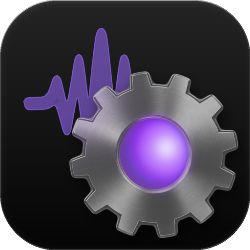

<div align="center">

  
  <h1>Jack Convolver</h1>
  <p>A native macOS interface for <code>jconvolver</code> and <code>fconvolver</code>, the JACK convolution engine by Fons Adriaensen, and the three programs built for macOS.</p>

  
  
  
  [](https://www.buymeacoffee.com/zinc75)

</div>

---

`jconvolver` is a matrix of convolutions in real time: any number of JACK inputs, any number of outputs, and an impulse response for each pair that needs one. It is used for reverbs, for decoders of Ambisonics, for the correction of loudspeakers and rooms, and for filter banks. The matrix is written in a text file, which tells where each impulse response comes from, with its gain and its delay. Its description is in `README.CONFIG`, and the examples of the author are installed with the programs.

Two more programs come with it. `fconvolver` does the same processing on sound files, without JACK. `makemulti` assembles single channel files into one multichannel file, for the impulse responses.

This edition raises the limit of the matrix from 64 to 128 inputs and 128 outputs, and gives the computation threads the real-time scheduling that macOS needs (see below).

Jack Convolver is an unofficial interface for these programs. It is part of Jack Apps Collection for macOS.

## The application

Jack Convolver edits the configuration of `jconvolver` as a matrix: each cell connects an input to an output, and an impulse response dropped on a cell fills it. The files of impulse responses are listed beside the matrix, with the channels of each file, and a folder can be added at once. The number of inputs and outputs (up to 128), the names of the JACK ports and the options of the engine are set in the same window. The configuration file stays an ordinary `jconvolver` file, which is shown as text, can be edited, and is written as `jconvolver` reads it.

The engine runs in real time on JACK, or on a sound file with `fconvolver`, without JACK. Its messages, its load and its xruns are shown, and the connections of its ports can be made in the application and written back to the configuration file.

Any impulse response can be inspected: waveform, spectrum, phase and group delay, alone or several together. The start, the length, the gain and the delay of a cell are set there, with a fade at both ends of the part that is read, and a conversion to the rate of the JACK server when the file has another one. A list of what is wrong with the configuration (missing files, rates that differ, channels that do not exist, ports named twice) is kept up to date, and a configuration can be exported as one audio file with all its impulse responses and a configuration file that points to it, to be sent as it is.

Each configuration is a session with its own window. A session keeps running when its window is closed, from the menu bar.

To build the application from source, see [`swiftui/README.md`](swiftui/README.md).

## Install the programs

Download `jconvolver-1.1.0-macOS.pkg` from the [Releases](https://github.com/zinc75/jack-apps-collection-macos/releases?q=jconvolver) page and open it. It installs `jconvolver`, `fconvolver` and `makemulti` in `/usr/local/bin`, and the description of the configuration files, the examples and the licences in `/usr/local/share/doc/jconvolver`.

It needs macOS 11 or later, and [JACK](https://jackaudio.org/downloads/) installed. To build from source instead, build the libraries of `libs/` (`fftw`, `zita-convolver`, `clthreads`, `libsndfile` and its codecs), then run `build_universal.sh` here.

## Use

Start JACK, then:

```
jconvolver /usr/local/share/doc/jconvolver/config-files/hilbert.conf
```

Connect the ports in your patchbay. Several examples need impulse response files that are not installed: the configuration file says where to download them, and its `/cd` line is the folder where they have to be.

Stop `jconvolver` with Control-C. A plain `kill` ends it in the middle of a cycle of JACK, which makes an xrun for every client of the server.

## Changes compared with upstream

**CLI.** The programs are built from the sources of the author, as universal binaries, with these changes:

- The computation threads of `zita-convolver` get a time constraint from JACK. On macOS the `SCHED_FIFO` policy that `zita-convolver` asks for leaves them in the time sharing band, and on a loaded Mac they run late. With 24 or 48 busy processes on the Mac, 64 convolutions of 4 seconds ran without a late cycle, where the original stopped with "CPU overload". `zita-convolver` gets an optional function, called at the start of each of its threads, and `jconvolver` uses it to ask JACK for the time constraint.
- The matrix goes up to 128 inputs and 128 outputs (the limit is 64 upstream), in `zita-convolver` and in `makemulti`. A decoder of 100 inputs and 64 outputs, with 6400 filters of 512 samples, runs at about half of one core at a JACK period of 256 frames. JACK needs enough ports for this: its limit is set with the `-p` option of `jackd`.

- A line `/input/name` or `/output/name` can name several ports to connect, not only one (`README.CONFIG` says so). Older versions of `jconvolver` connect only the first and ignore the others.
- `jconvolver` prints the name that JACK gave to its client, which JACK may have changed to avoid a clash, so that a program that starts it can find its ports.

**Application.** `jconvolver` has no graphical interface upstream. Jack Convolver is new code, under the same licence as the programs. It starts the programs of this edition, reads what they print, and reads and writes their configuration files as upstream defines them: a configuration written by the application runs with the Linux version too, apart from the ports beyond the first on a line, which that version ignores.

## History

An installer of jconvolver 0.9.2 for macOS was published in 2012 by Matthias Kronlachner, [in this post](https://www.matthiaskronlachner.com/posts/jconvolver-0-9-2-for-mac-os-x/). He noted that the computation threads could be late on macOS. His multichannel plug-ins, [mcfx](https://github.com/kronihias/mcfx), include a convolver that reads the same configuration files.

## Support

jconvolver is free and open source. If this build saves you time, you can buy me a coffee: it helps pay the Apple Developer account ($99 a year) that keeps the installers signed and notarized.

[](https://www.buymeacoffee.com/zinc75)

## Upstream

| | |
|---|---|
| Project | jconvolver |
| Author | Fons Adriaensen |
| Source | https://kokkinizita.linuxaudio.org/linuxaudio/downloads/jconvolver-1.1.0.tar.bz2 |
| Version | version 1.1.0 (archive downloaded 2026-10-31); no git history upstream. Configuration files are described in `upstream/README.CONFIG`; examples in `upstream/config-files/`. |
| Archive | `jconvolver-1.1.0.tar.bz2`, attached to the release `1.1.0` of the repository named below |
| SHA-256 | `ac5a11372d7325929c86966c7d2288a9276e65c43b29a50017c37a5e660ed80d` |
| Copy here | `upstream/` = a Git submodule of [zinc75/jconvolver-releases](https://github.com/zinc75/jconvolver-releases), at tag `1.1.0` (commit `623efebf2de92dd81ac540487987c2d161ee3a2e`): the files of the archive above, **unmodified** (clone with `--recurse-submodules`) |

That repository holds release snapshots, one commit per release; it is not a mirror, because Fons Adriaensen publishes release archives only and has no Git repository.

## Licence

The sources of `jconvolver` say GPL version 2 or any later version. The programs are linked with `zita-convolver`, which is under version 3 or any later version, so the programs of this edition are distributed under version 3 of the GPL. The libraries linked into them (FFTW, `clthreads`, libsndfile and its codecs) have their own licences, listed in the package.

## State on macOS

The application needs macOS 15. It is developed and tested on macOS 26, where it uses Liquid Glass; the look used on macOS 15 has not been tested on a real system.

The three programs run on arm64 and on x86_64, from macOS 11. `jconvolver` and `fconvolver` need `zita-convolver`, FFTW and libsndfile, `jconvolver` also `clthreads` and JACK; they are linked statically, and only `libjack` stays dynamic.

macOS has no `mlockall`, which `jconvolver` calls at start to keep its memory in RAM: the call is left out, so that it does not print a warning. In a run of 100 seconds with a large matrix, `jconvolver` did not wait for a page of memory once after its start.

Tested on macOS, on arm64 and on x86_64 (under Rosetta).

## Layout

- `upstream/`: the original sources, never edited (a Git submodule).
- `patches/`: changes to the upstream sources, as unified diffs.
- `swiftui/`: the Jack Convolver application, see its [README](swiftui/README.md).
- `build_universal.sh`: builds the three programs and writes their licence texts (needs the libraries of `libs/` built first).
- `VERSION`, `REVISION`: the upstream version and the number of this macOS edition.
