<div align="center">

  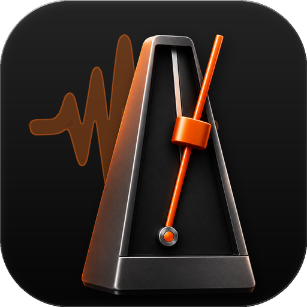
  <h1>Klick</h1>
  <p>A native macOS interface for <code>klick</code>, the JACK metronome by Dominic Sacré.</p>
  <p>
    
    <strong>Signed &amp; notarized by Apple</strong>
  </p>

  
  
  
  [](https://www.buymeacoffee.com/zinc75)

  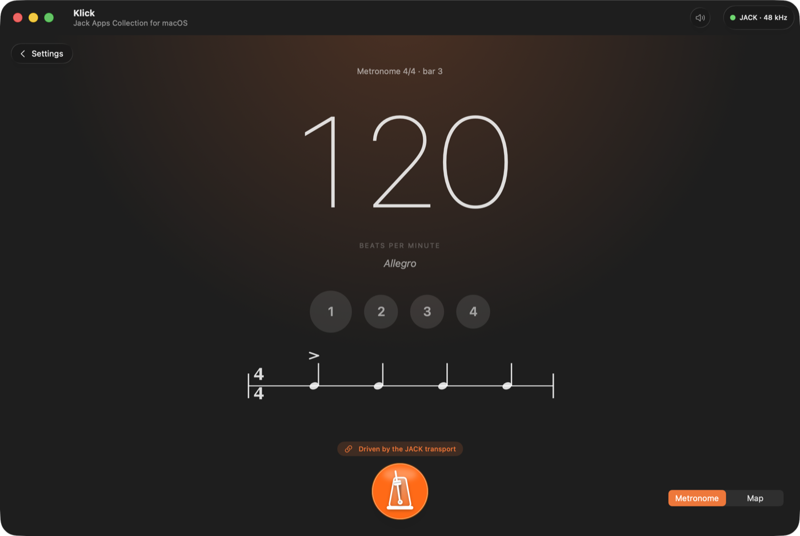

</div>

---

A metronome with tempo maps that plays into your JACK server, and that can follow the JACK transport. Pick the engine on the Output page: CoreAudio, for the output of the Mac, or JACK. The application embeds the engine of `klick`, built here for macOS (arm64 and x86_64) with a few small patches, and installs the `klick` command-line program too.

Klick is an unofficial interface. It is part of Jack Apps Collection for macOS. The same application without JACK is [Klick Tempo](https://github.com/zinc75/klick-tempo), for musicians who do not use JACK.

## Install

Download `Klick-0.13.0-macOS.pkg` from the [Releases](https://github.com/zinc75/jack-apps-collection-macos/releases?q=Klick) page and open it. The package is signed and notarized by Apple, so it opens without any Gatekeeper warning. It installs the application in `/Applications/Jack Apps Collection/` and the `klick` program in `/usr/local/bin`.

It needs macOS 15 or later, and [JACK](https://jackaudio.org/downloads/) installed to use the JACK engine. To build from source instead, see [`swift/README.md`](swift/README.md).

## Play in JACK

Choose JACK as the engine and Klick opens one output port, `Klick:out`, in the server. It connects it to the first two hardware outputs by itself if you want, and a list of the input ports of the server lets you connect it anywhere else, with the icons of the applications when JackMoebius or JACK metadata identifies them. If the server stops, Klick goes back to CoreAudio and offers to try JACK again. The beat lights take the latency that JACK announces into account.

<div align="center">
  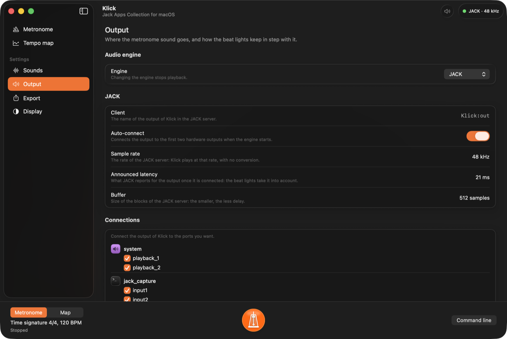
</div>

## Follow the JACK transport

In the advanced options of the Output page, Klick can wait for the JACK transport: the metronome, or the tempo map, starts when the transport rolls, from its first beat, and stops with it, without a press on the button. The window says it is waiting for the transport, or driven by it.

<div align="center">
  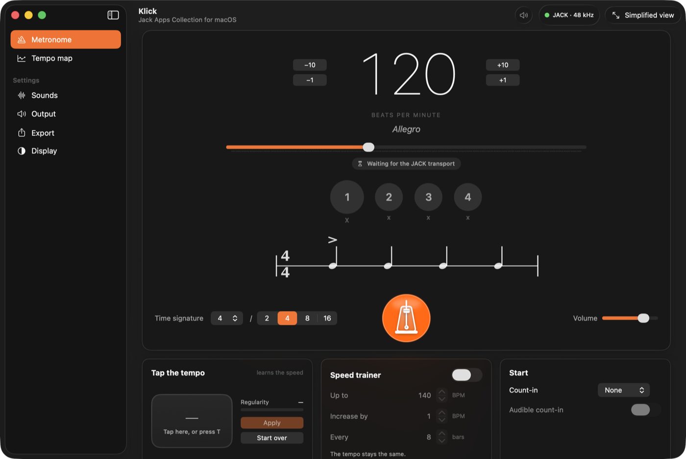
</div>

Klick can also be the timebase master of the transport, giving the other clients its tempo, its meter and the position in bars and beats, as `klick` does. When another client is the timebase master, the metronome takes its tempo and meter and joins the song on the beat; a tempo map keeps its own tempo and says so.

## The metronome

Tempo from 30 to 260 BPM with a slider, buttons or the arrow keys, any meter, an accent or a silence on each beat, a count-in, tap tempo and a speed trainer that raises the tempo by a step every few bars up to a target.

<div align="center">
  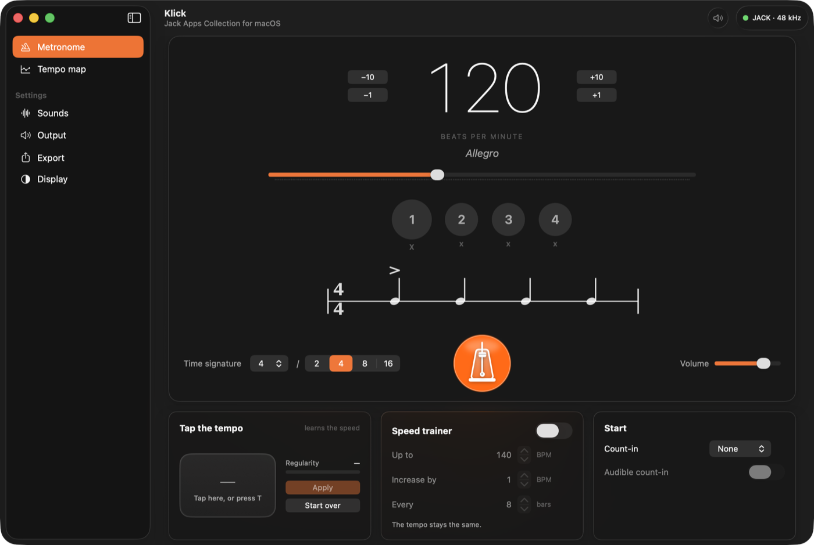
</div>

## Tempo maps

A map is a text file, in the format of `klick`, with one line per section: its bars, meter, tempo or tempo ramp, accents and volume. Open one, edit the sections in the table, start from any section, and follow the course of the tempo on the timeline.

<div align="center">
  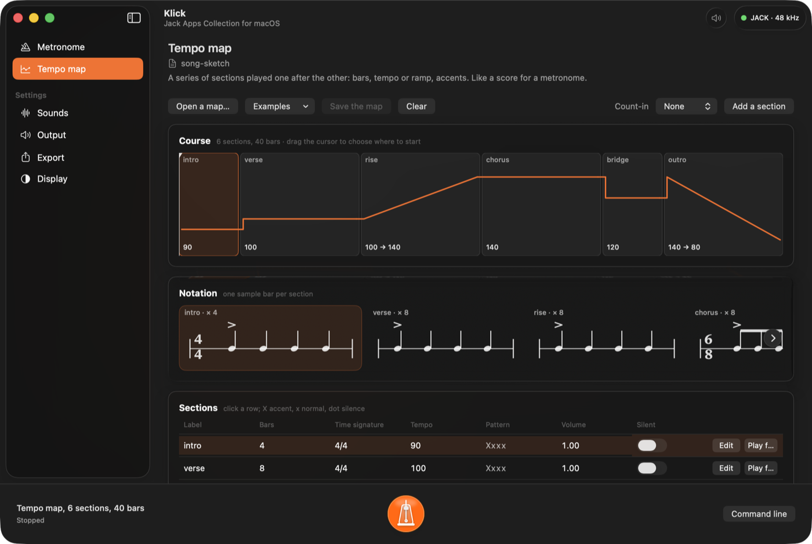
</div>

While a map plays, the simplified view shows the section, the bar and the next section.

<div align="center">
  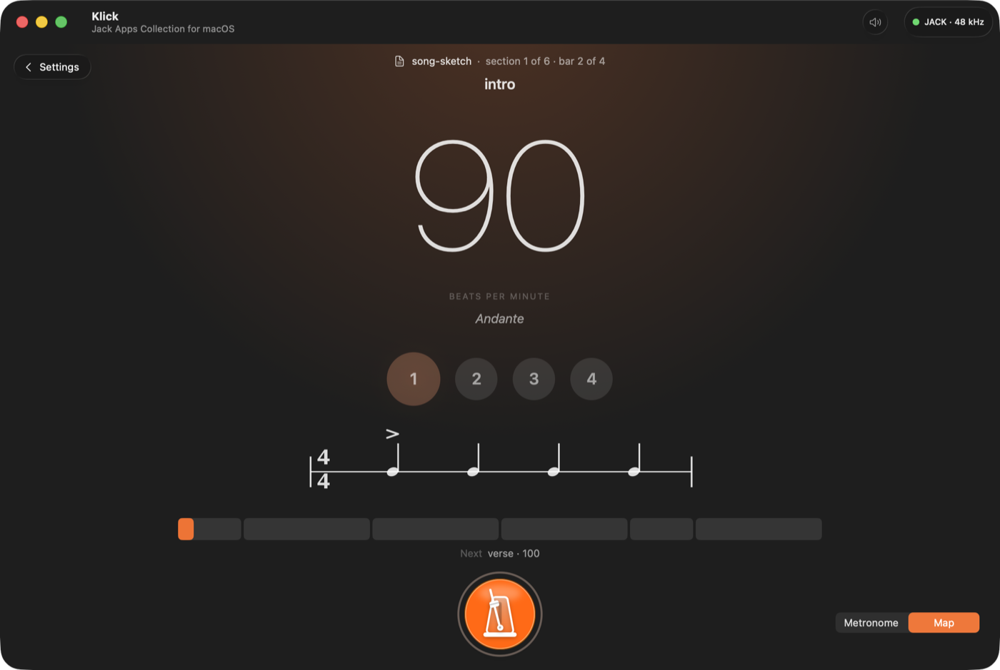
</div>

## Sounds, export, display

Square, sine, noise and click sounds, with a pitch and a volume for the accent and for the other beats, or your own files. A metronome or a map can be written to an audio file (WAV) or to a MIDI file. The window is dark by default, and follows the system or stays light if you prefer; the accent color can be changed. The Output page also keeps CoreAudio, for the output of the Mac, with the offset of the beat lights set by ear for outputs that delay the sound.

<div align="center">
<table>
<tr>
<td align="center">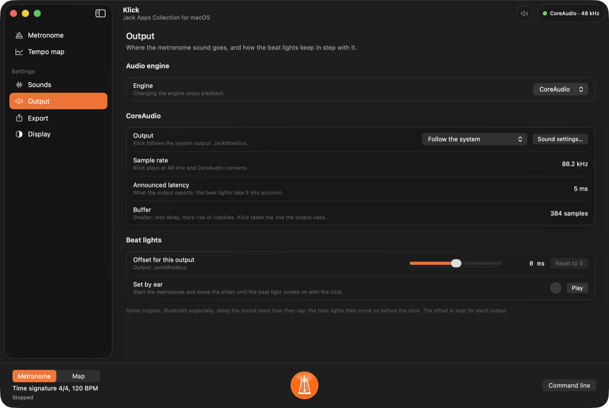<br><sub>Output, with CoreAudio</sub></td>
<td align="center">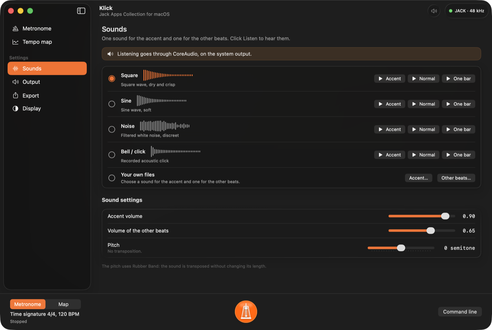<br><sub>Sounds</sub></td>
</tr>
<tr>
<td align="center">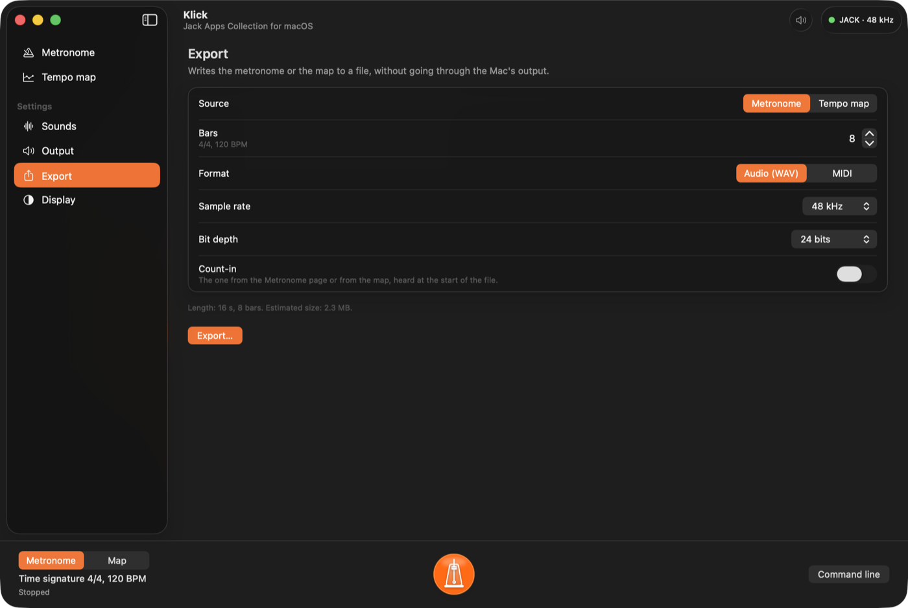<br><sub>Export to WAV or MIDI</sub></td>
<td align="center">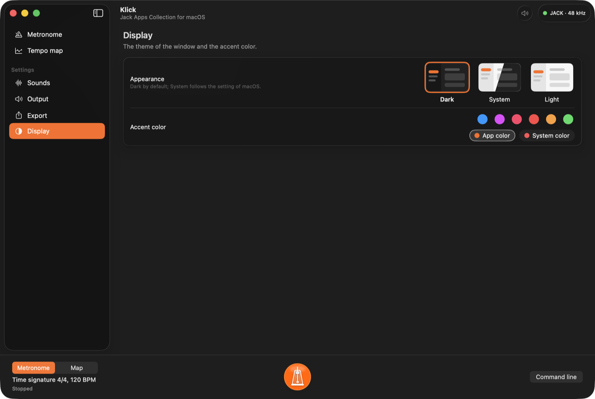<br><sub>Display</sub></td>
</tr>
</table>
</div>

Klick without JACK is also published as [Klick Tempo](https://github.com/zinc75/klick-tempo).

The interface is in French, English, German, Italian and Spanish. The German, Italian and Spanish translations were written without a native speaker: corrections and new languages are welcome, see [`CONTRIBUTING.md`](../CONTRIBUTING.md).

## Uninstall

There is no uninstaller. To remove what the package installed:

```
sudo rm -rf "/Applications/Jack Apps Collection/Klick.app" /usr/local/bin/klick /usr/local/share/doc/klick
sudo pkgutil --forget io.github.zinc75.jackappscollection.klick.pkg
```

The settings of the application are in `~/Library/Preferences/io.github.zinc75.jackappscollection.klick.plist`; `defaults delete io.github.zinc75.jackappscollection.klick` removes them. Your maps are not touched.

## Support

Klick is free and open source. If it saves you time, you can buy me a coffee: it helps pay the Apple Developer account ($99 a year) that keeps the installers signed and notarized.

[](https://www.buymeacoffee.com/zinc75)

## Changes compared with upstream

**CLI.** The `klick` program is upstream's, with five small patches that do not change what it does (its exports are byte for byte the same). They let the engine find its sounds in the application, send an event for each beat, follow any transport and not only JACK's, and start after a delay or from a given bar and beat. The details are in [`klick-tempo/klick/README.md`](klick-tempo/klick/README.md).

**GUI.** The application is a graphical interface for what `klick` does with its command line and OSC messages, with a table and a timeline for tempo maps. It adds:

- it also works without JACK, with a CoreAudio engine, and takes over if the JACK server stops;
- beat lights that follow the real beat, silent beats included;
- export of a metronome or a map to a MIDI file, in addition to the audio file.

## Upstream

The program is `klick` by Dominic Sacré, https://github.com/dsacre/klick, see [`klick-tempo/klick/README.md`](klick-tempo/klick/README.md) for the commit used and the patches.

## Licence

GPL-2.0-or-later, as `klick`. The libraries linked into the application have their own licences, listed in the application and in the package.

## State on macOS

Tested on macOS, on arm64 and on x86_64 (under Rosetta), against a JACK server of its own.

## Layout

- `klick-tempo/`: the [Klick Tempo](https://github.com/zinc75/klick-tempo) repository, as a Git submodule: the engine of `klick` with its patches, the core of the application, and the libraries. Clone with `--recurse-submodules`.
- [`engine/`](engine/): the JACK backend of the engine, loaded at run time (nothing is linked against libjack), with its tests.
- [`swift/`](swift/): the Klick application: the JACK page and options on top of the core of Klick Tempo, with its tests and build script.
- `screenshots/`: the images of this README.
