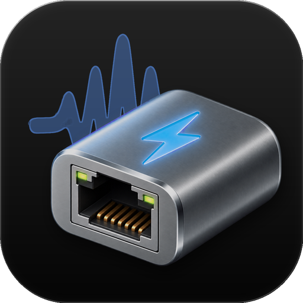
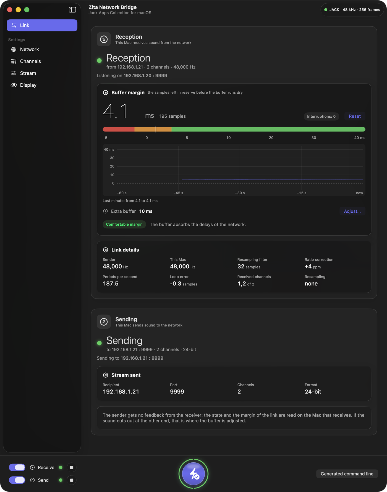
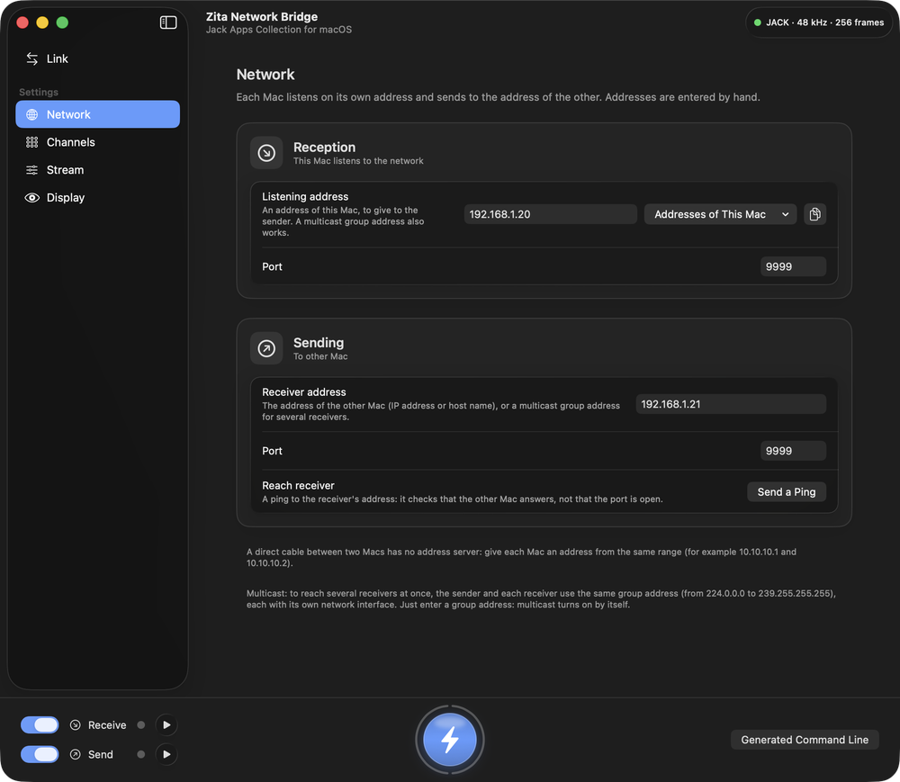
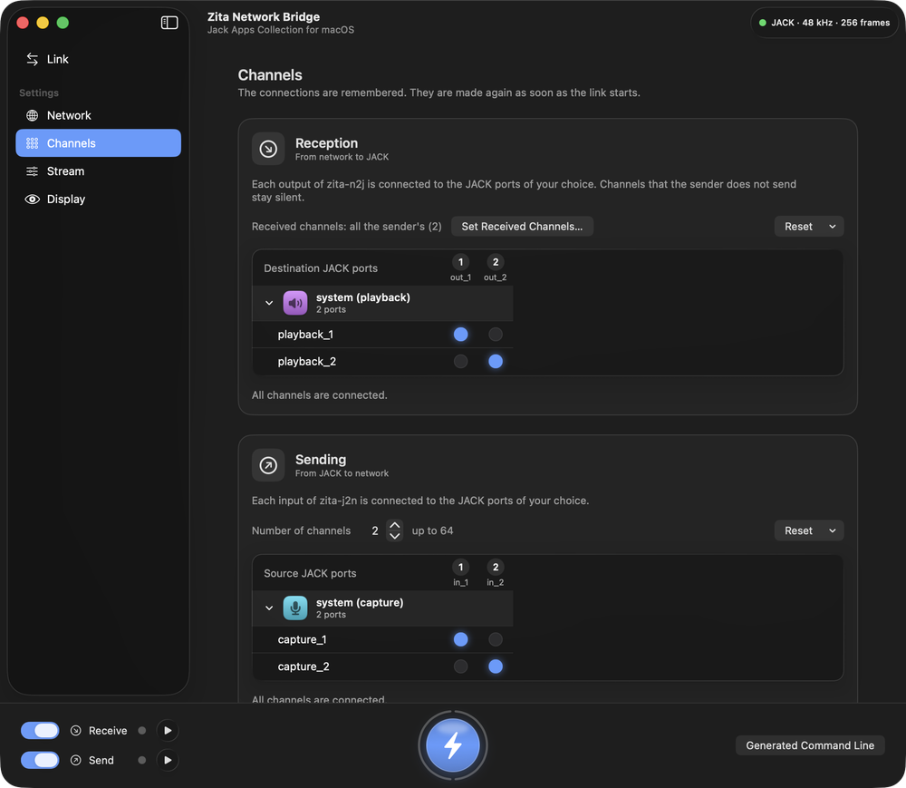
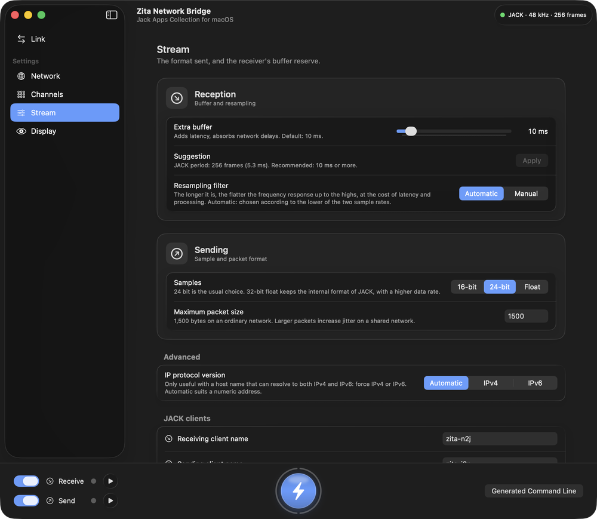
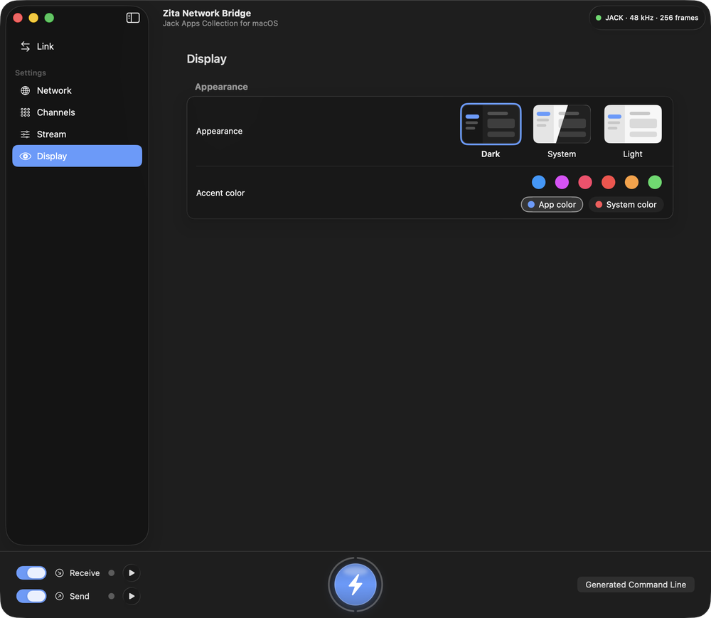

<div align="center">

  
  <h1>Zita Network Bridge</h1>
  <p>A native macOS interface for <code>zita-njbridge</code> by Fons Adriaensen: JACK audio between two Macs over an IP network.</p>

  
  
  
  [](https://www.buymeacoffee.com/zinc75)

  

</div>

---

One Mac sends the channels of its JACK server, another receives them as JACK ports, up to 64 channels, over UDP or multicast. The two clocks are never exactly the same, so the receiver resamples the stream by a very small, adaptive ratio, and a short buffer absorbs the delays of the network. Zita Network Bridge starts the two programs of `zita-njbridge` (`zita-j2n` sends, `zita-n2j` receives), reads the state of the link, connects the JACK ports and tells whether the buffer is large enough. The programs are built here for macOS (arm64 and x86_64) and keep all their options.

Zita Network Bridge is an unofficial interface. It is part of Jack Apps Collection for macOS.

## Install

<p align="center"><a href="https://github.com/zinc75/jack-apps-collection-macos/releases/download/zita-njbridge-v0.4.8-macOS-3/ZitaNetworkBridge-0.4.8-macOS-3.pkg"></a></p>

Download `ZitaNetworkBridge-0.4.8-macOS-3.pkg` from the [Releases](https://github.com/zinc75/jack-apps-collection-macos/releases?q=Zita+Network+Bridge) page and open it. It installs the application in `/Applications/Jack Apps Collection/`, and `zita-j2n` and `zita-n2j` in `/usr/local/bin`, with their manual pages.

It needs macOS 15 or later, and [JACK](https://jackaudio.org/downloads/) installed. To build from source instead, see [`swiftui/README.md`](swiftui/README.md).

## Receive, send, or both

Choose what this Mac does with the two switches at the bottom of the window, then start with the round button. The two directions are independent: a Mac can receive from one and send to another at the same time. Each direction has its own state, green once the link is up and orange while it waits for the sender or synchronises, with the same colour on the ring of the button.

The Link page shows the state of each direction. For a receiver it reads the buffer margin: the samples left in reserve before the buffer runs dry, in milliseconds, with a gauge, the last minute as a graph, and a count of the interruptions. From the period of the JACK server, the page says if the extra buffer is enough (10 ms for periods up to 256 frames, 20 ms at 512, 30 ms at 1024) and offers to apply the value. The sender gets no answer from the receiver, so the state of the link is read on the Mac that receives.

## Network

<div align="center">
  
</div>

The addresses are typed by hand. The address of a link is always the one of the receiver: it listens on one of its own addresses, and the sender sends to it. The receiver has a menu of the addresses of the Mac, with the interface of each, and a button that copies the chosen one. The sender can send a ping to the receiver, which tells that the other Mac answers, not that the port is open.

An address that cannot be one is flagged, an IPv6 link-local address gets the interface it needs (`fe80::1%en0`), and a group address of multicast is recognised as such, with the interface it requires: there is no switch to set.

## Channels

<div align="center">
  
</div>

A matrix per direction connects the ports of the programs to the JACK ports of your choice, grouped by client. The connections are remembered and made again each time the link starts. The receiver takes all the channels of the sender, or only the ones chosen, which splits a large stream between several receivers.

## All the options of the programs

<div align="center">
<table>
<tr>
<td align="center"><br><sub>Network</sub></td>
<td align="center"><br><sub>Channels</sub></td>
</tr>
<tr>
<td align="center"><br><sub>Stream</sub></td>
<td align="center"><br><sub>Display</sub></td>
</tr>
</table>
</div>

The Stream page has the extra buffer of the receiver, the length of the resampling filter (automatic, or from 16 to 96 samples, with the latency it adds), the format of the samples (16 bits, 24 bits or float), the size of the packets, the hops of multicast, the version of IP, and the names of the two JACK clients. The command line that the application runs can be shown at any time. A change that needs a restart of a program is applied from a banner, which says that the sound is cut for a moment.

The programs are also usable alone and keep all their options:

```
zita-n2j 192.168.1.20 9999
zita-j2n 192.168.1.20 9999
```

`zita-n2j --info` prints the state of the link, and `man zita-njbridge` has the rest. The settings of the application are kept between launches. The interface is in French, English, German, Italian and Spanish. The German, Italian and Spanish translations were written without a native speaker: corrections and new languages are welcome, see [`CONTRIBUTING.md`](../CONTRIBUTING.md).

## Uninstall

There is no uninstaller. To remove what the package installed:

```
sudo rm -rf "/Applications/Jack Apps Collection/Zita Network Bridge.app" /usr/local/bin/zita-j2n /usr/local/bin/zita-n2j /usr/local/share/doc/zita-njbridge
sudo rm -f /usr/local/share/man/man1/zita-j2n.1 /usr/local/share/man/man1/zita-n2j.1 /usr/local/share/man/man1/zita-njbridge.1
sudo pkgutil --forget io.github.zinc75.jackappscollection.zitanjbridge.pkg
```

The settings of the application are in `~/Library/Preferences/io.github.zinc75.jackappscollection.zitanjbridge.plist`; `defaults delete io.github.zinc75.jackappscollection.zitanjbridge` removes them.

## Support

Zita Network Bridge is free and open source. If it saves you time, you can buy me a coffee: it helps pay the Apple Developer account ($99 a year) that keeps the installers signed and notarized.

[](https://www.buymeacoffee.com/zinc75)

## Changes compared with upstream

**CLI.** The programs are built from upstream's sources, as universal binaries, with two small patches (`patches/`). On macOS, the network threads that upstream starts with `SCHED_FIFO` stay in the time sharing band, and on a loaded Mac the buffer of the receiver ran dry. The patch asks JACK to give these threads the time constraint that it gives to its own. With 24 busy processes on the Mac, the smallest margin of the buffer was -3901 frames without it and 194 frames with it, as on an idle Mac (JACK period of 256 at 48 kHz). The second patch leaves out the call to `mlockall`, which does not exist on macOS and made both programs print "memory lock failed" at start; in a run of 100 seconds the programs did not wait for a page of memory once.

**GUI.** The application adds what the programs do not show:

- The state and the numbers of the receiver, read from `zita-n2j --info`. Its output is fully buffered when it goes through a pipe, so the program runs in a pseudo-terminal that the application owns, and stops with it.
- The buffer margin in milliseconds, with its history, the count of interruptions and the advice from the period of the JACK server.
- The matrices that connect the ports of the programs to the JACK ports, remembered and made again at each start, and the choice of the channels that the receiver takes.
- The addresses of the Mac, the check of an address, the zone of an IPv6 link-local address, the multicast deduced from the address, and a ping to the receiver.
- The two directions together, each with its own state, started and stopped from one button, and the restart of a program when a setting that it reads at start has changed.
- The command line of each program, to copy into a Terminal.

## Upstream

| | |
|---|---|
| Project | zita-njbridge |
| Author | Fons Adriaensen |
| Source | https://kokkinizita.linuxaudio.org/linuxaudio/downloads/zita-njbridge-0.4.8.tar.bz2 |
| Version | version 0.4.8 (archive downloaded 2026-10-31); no git history upstream. |
| Archive | `zita-njbridge-0.4.8.tar.bz2`, attached to the release `0.4.8` of the repository named below |
| SHA-256 | `101176a0bd407cab7bffd326e8d6886c1b65b212bc33f2efb97b03f926c47907` |
| Copy here | `upstream/` = a Git submodule of [zinc75/zita-njbridge-releases](https://github.com/zinc75/zita-njbridge-releases), at tag `0.4.8` (commit `378152fceaf57001b562a873aabe704b8b74ea62`): the files of the archive above, **unmodified** (clone with `--recurse-submodules`) |

That repository holds release snapshots, one commit per release; it is not a mirror, because Fons Adriaensen publishes release archives only and has no Git repository.

## Licence

GPL-3.0-or-later (`COPYING` is the GPL v3; source headers: "version 3 … or any later version"). The application is under the same licence.

Dependencies: JACK, zita-resampler (`libs/zita-resampler`).

## State on macOS

The programs build as universal binaries (arm64 and x86_64), with the patch described above and no other change to the sources.

Tested between two Macs over direct gigabit Ethernet. With a JACK period of 256 the defaults are enough; with 1024, use `zita-n2j --buff 30` or more. Resampling between 48 kHz and 44.1 kHz keeps pitch and level exact. Other periods were not tested.

macOS has no `mlockall`: the call is left out, so the programs do not print "memory lock failed" any more.

## Layout

- `upstream/`: the original sources, never edited (a Git submodule).
- `patches/`: changes to the upstream sources, as unified diffs.
- `build_universal.sh`: builds the two universal programs and writes their licence texts (needs `libs/zita-resampler` built first).
- `swiftui/`: the application, with its tests and build script.
- `screenshots/`: the images of this README.
- `VERSION`, `REVISION`: the upstream version and the number of this macOS edition.
